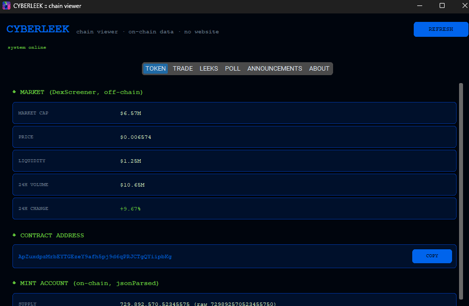
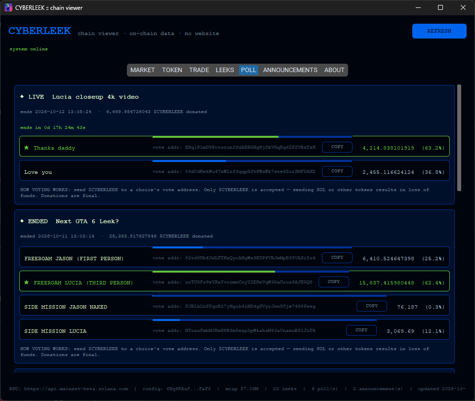

# CyberleekViewer

A desktop **chain viewer** for the CYBERLEEK site, built with Python + customtkinter.
It reads everything straight from **Solana mainnet RPC** — no website, no browser,
no backend, no wallet connect.


## Screenshots

*Main UI: token info, trade links, and the on-chain LEEKS list with mirrors.*



*Poll tab: live vote bars from token balances, vote addresses, countdown.*



## ✨ Features

- **TOKEN** tab — live mint account from the chain (supply, decimals, mint/freeze authority — revocation confirmed on-chain).
- **TRADE** tab — swap links (Raydium, DexScreener, Birdeye, defined) straightfrom the on-chain config
- **LEEKS** tab — every content account sorted by timestamp
- **POLL** tab — vote bars computed from real token-account balances
- **ABOUT** tab — on-chain about/mission/FAQ/contact and section flags.
- **Auto-refresh** every 90 s (or hit REFRESH)
- **Portable Windows executable** — `dist\CyberleekViewer.exe`, no Python needed.

## 💻 How to Use (Easy Way)

1. Go to the [**Releases**](https://github.com/ZeroHackz/cyberleek-viewer/releases) page,
   download the latest `CyberleekViewer.zip`, extract it, and run
   `CyberleekViewer\CyberleekViewer.exe` — no Python or dependencies needed.
2. Run the application. It fetches on-chain state automatically on startup.
3. Pick a tab:
   * **TOKEN** — check the mint account.
   * **TRADE** — check a swap link
   * **LEEKS** — On-chain urls
   * **POLL** — watch live voting
   * **ABOUT** — read the on-chain config.
4. That's it. Data refreshes automatically; the status bar shows everything.

## 🛠️ For Developers (Building from Source)

1. Install Python 3.10+ and get the project:
   ```bash
    git clone https://github.com/ZeroHackz/cyberleek-viewer.git
    cd cyberleek-viewer
   ```
2. First run — `launcher.bat` creates the virtual environment, installs
   dependencies, and starts the app.
3. To build the portable executable:
   ```bat
   build.bat
   ```
   The app folder lands in `dist\CyberleekViewer\`
4. Enjoy the view.


## Project layout

```
cyberleek-viewer/
  app.py             # customtkinter GUI
  cyberleek.py       # RPC client + on-chain decoders (no UI deps)
  make_icon.py       # icon generator
  cyberleek.spec     # PyInstaller spec
  launcher.bat       # first-run setup + launch (no console window)
  build.bat          # builds dist\CyberleekViewer\ + auto-zips it
  smoke.py           # headless GUI smoke test
  requirements.txt
  assets/icon.ico    # app + exe icon
  screenshots/
  dist/              # build output (git-ignored, released via GitHub Releases)
```

## ⚖️ Disclaimer

- **No Affiliation**: This project and its author are not affiliated,
  associated, authorized, endorsed by, or in any way officially connected with
  Rockstar Games, Take-Two Interactive, Cyberleek, or any of their subsidiaries
  or affiliates.
- **Educational & Research Purposes Only**: This is an independent viewer
  provided solely for educational research into decentralized publishing
  patterns; it only reads public on-chain data.
- **Content Responsibility**: The author does not host, stream, generate, or
  claim ownership of any third-party media, leaked content, or intellectual
  property. All product names, logos, brands, and media mentioned or displayed
  belong to their respective copyright holders.
- **Use at Your Own Risk**: Software is provided "as is", without warranty of
  any kind. You are solely responsible for ensuring compliance with your local
  laws and host provider terms of service.
